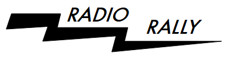

# Competitor Packet
Here's what to expect in a competitor's information packet.

## Script
Here is the script to use when communicating with net control. You do not have to recite this script perfectly to get your responses into net control.

## Channel and Mode Table
This is a table with the frequencies and modes used during the event. The primary channel is the most difficult, but gets you the most points. The alternate channel is a little easier, but gets less points, and the contingent channel is the easiest but gets the least points.

## Task Envelopes
You have an envelope of task envelopes. The small envelopes have a number on them which corresponds with your operating location. Each operating location will have at least 4 letters (Alpha, Bravo, Charlie, etc). Do not open these envelopes until we give you your task. You will have to turn in all materials at the end of the event. If you turn it missing or too many opened envelopes, you will be penalized. 
 
## Table of Operating Locations and Drive Times
You have had access to these locations since the event was announced. This table has every location cross referenced with every other location. The intersection of the row and column has the standard drive time between these two locations. You will need to use this table to make time card calculations.

## Time Card
You should have at least four blank time cards. You will be using one of these per stage. We will go over how to fill this out in a bit.

#### Authentication Table
Each team will have one authentication table. This is unique to your team. Do not lose this. Net control will have a copy as well.

## Survey
You have four survey sheets. Be sure each team member fills out a survey when you get back to HQ later. This is critical to continuous improvement of the event.

## Extras
Some events may require extra materials like maps, reference sheets, measurement tools, nomograms, or other bits required for the event.

## Dope Card
The dope card is a reference to use when calculating your times. We use this to make adjustments to times based on weather, traffic, and other things that may change on the day of the event. Lets go over the dope card right now.

First on the dope card is the bogey time. The bogey time is some flex time we use to adjust drive times. Write this down on your dope card. For this event, the bogey time is xx minutes.

Next on the dope card is setup time. This is the setup time you are allotted to unpack and set up your station. For this event the setup time is xx minutes.

Next on the dope card is packup time. This is the time allotted to break down and pack up your station. For this event the setup time is xx minutes.

The last thing on your dope card is your first location. <read out each team's first location>

Double check that the first location number we gave you matches your task envelopes. 

Lets confirm your locations. Go over each team and have them read back and confirm their operating locations.

Radio Rally © 2026 by KI4RXJ Darrell Krueger is licensed under CC BY-NC-SA 4.0 
