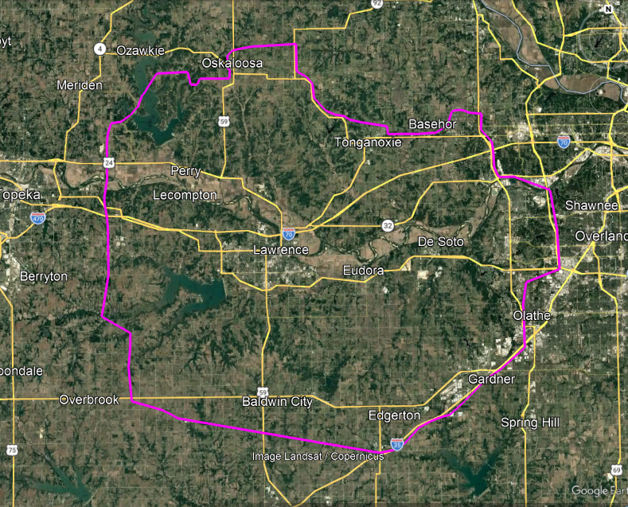

# Event Organizing
This section is for resources for event organizers. Organizers should have redundancies in nearly every area to ensure smooth event operation.

Use the [event planning spreadsheet](./radio_rally_planning.ods) to plan and operate the event. (LibreOffice ODS file)

## Planning
Note, planning on the front end for your first event will take some time, but once your area of operations and your operating locations are set, you will spend much less time planning subsequent events. Consider it an investment in the club!

If you have not planned an event before, give yourself 6-12 months of planning time. This will let you do your planning in small, digestible chunks, and not have a panic a month before the event is scheduled. Once you have a list of operating locations and basic tasks, you can shorten your planning window down to 2-4 months lead time.

### Area of Operations
**1. Define a core area for your area of operations (AO)**.

  Select small core area in the center of your planned area of operations. It should take no more than 5-10 minutes to travel from one side of your core area to the other.

**2. Define the boundary of your AO.**
  
  Mark a boundary of your AO such that it balances drive time with radio time. Generally this is about 20-25 minutes of travel time in any direction. If there are excellent operating locations within a couple of extra minutes of the boundary, extend the boundary, but only if the competitors get a better experience. Note: Your AO may turn into a very interesting shape depending on the roads or trails in the area.

* Half-day county-wide events on VHF/UHF generally cover 1,000 sqare miles, or about 32 miles x 32 miles. Shoot for a maximum 20-25 minute drive in either direction from the core.

* HF events using NVIS propagation generally cover larger areas. Shoot for about 6,000 square miles, or about 75 miles x 75 miles. Plan for a maximum 45-50 minute drive in either direction from the core. 

* City-wide events with HT's or low power radios are approximately 100 square miles, or 10 miles x 10 miles or smaller. Try to keep city-wide events with no more than 10 to 15 minutes of travel time between locations.

### Operating Locations
**1. Draft a list of operating locations (OL)**
  
  Within the AO, develop a draft list of operating locations. If you are a team of organizers, create your list in a shared Google Earth space so everyone can contribute. Have a good balance of familiar locations (larger parks and public areas) and lesser known locations (roadside and rural parks). Make sure your draft list has 70-90 locations. Several of these will be culled down to a final list. 

**2. Edit your list of OL's online**

  Review all of your operating locations for suitability. Start your inspections with satellite imagery and street-view imagery. Evaluate basic accessibility, antenna clearances, open-hours, RF-environment, and options for competitor tasks.

**3. Edit your list of OL's in person**

  With your edited list of OL's, take time to visit your OL's in person. Walk around and snap photos of the area with a particular interest of things that cannot be readily seen from street-view. Snap overall photos for general context, and snap detailed photos of signs, objects, and anything else that may be useful for for planning competitor tasks.
  
  Do not go below 50 operating locations per 1,000 sq miles. 50 locations provides just enough uncertainty for participants on where they will operate. 50 locations also provides for a capacity of about eight teams without duplicating locations. Add more sites if they provide a good radio, trivia, or geographic challenge. Add more sites if you wish to host more than eight teams. Do not exceed 70-80 operating locations per 1,000 sq miles, as managing the data and tasks for the event become burdensome at that level.

### Channels and Modes
Select three channels that are accessible, of interest, and present a reasonable challenge to participants. Select modes that can challenge participants and are reasonably within capabilities of your participants. 

* Primary : Most challenging.
* Alternate : Moderate challenge.
* Contingent : Least challenge. Usually uses a repeater.

For example, if a club is trying to promote DMR, make DMR the mode for the primary channel. Alternate modes might consist of something like simplex, which could be a challenge at longer distances from the HQ. Teams may need to employ directional antennas or find a nearby hill to make contact from. Contingent channels should be the easiest to access. A good default for the contingent channel is the club repeater.

Here are some ideas for bands and channels.

- **E = Easy (Technician or License Free Friendly)**
- **M = Medium**
- **C = Challenging**

#### **VHF / UHF**

| Band | FM Voice | DMR Voice | SSB Voice | APRS | JS8Call | VARA FM | VARA HF | MT63 | Meshcore |
| ----------- | ----------- | ----------- | ----------- | ----------- | ----------- | ----------- | ----------- | ----------- | ----------- |
| 10 m       | M | N/A | E   | M   | E   | N/A | M   | M   | N/A |
| 6 m        | M | N/A | E   | E   | E   | E   | N/A | M   | N/A |
| 2 m        | E | E   | C   | E   | E   | E   | N/A | M   | N/A |
| MURS       | E | N/A | N/A | N/A | N/A | N/A | N/A | N/A | N/A |
| 70 cm      | E | E   | C   | E   | E   | E   | N/A | M   | N/A |
| FRS / GMRS | E | N/A | N/A | N/A | N/A | N/A | N/A | N/A | N/A |
| 33 cm      | C | C   | C   | C   | C   | C   | N/A | C   | E   |

#### **HF**

| Band | SSB Voice | JS8Call | RTTY | HELL | Winlink |
| ----------- | ----------- | ----------- | ----------- | ----------- | ----------- |
| 6 m  | E | E | E | M | M |
| 10 m | E | E | E | E | M |
| 40 m | M | E | C | C | M |
| 60 m | C | C | C | C | C |
| 80 m | C | C | C | C | C |

### 3. Event Format
Select a format of your event based on tasks and operating locations using the M x N format.
- M = number of operating locations
- N = number of tasks per operating location

The most common format for half day events will likely be 3 x 1 or 4 x 1.

Example:
- A 3 x 1 event consists of three operating locations and one task to perform at each operating location at the given time.
- A 1 x 3 event consists of one operating location and three tasks to perform at the operating location at various times during the event.
- A 2 x 2 event consists of two operating locations and two tasks to perform while at a given operating location. Tasks are to be performed at different times per the event's instructions.

If you're not sure how to structure an event, start with a county-wide 3 x 1 event.

Use this spreadsheet to organize and operate your event.
[event planning spreadsheet](./radio_rally_planning.ods)

## 4. Check In and Tasks
### Check In
For each location, a team must check in within their window. Teams do not have to be exactly at the location for successful check in, but the important thing is that they check in on time. To ensure net control is speaking with the correct team, each team is issued a unique authentication table at the beginning of the event. Use the provided spreadsheet to generate an authentication table. Copy-and paste the table as an image into the information packet for the teams. Check ins are recorded by net control, and an official time is given to the team.

### Tasks
For each location, have a minimum of four tasks that can be completed by teams. More variety is better. Tasks should fall under the following categories:
1. Observation
2. Measurement
3. Communication

#### Observation
Observation tasks require a team to carefully observe their surroundings and report on their findings. For example, a team may need to find a historical marker, sign, or other object and report on what is displayed.
> "According to the historical marker nearby, who was the last serving postmaster of the town? (J.T. McMillan)
> "At this location, there is a picnic shelter. How many picnic tables are under the shelter?" (Eight Picnic Tables)
> "At this location, there is a sign indicating the operator of the quarry. What is the telephone number of the quarry office? (785-555-3182)

#### Measurement
Measurement tasks require a team to physically interact with something in their surroundings. A measurement might require a tape measure, inclinometer, or other tool. Organizers may elect to provide the tool or have the teams provide their own.
> "Using the provided tape measure, what is the the inside width (in inches) of the footpath bridge at this location? (72 inches)
> "Using the provided inclinometer, what is the angle of the boat ramp as measured just above the water line? (10 degrees from horizontal)

#### Communication
Communication tasks require a team to handle complex information or retrieve information from another source.
> Tongue Twister - "At this location there is a unique club flyer posted on the bulletin board. What is the phrase written at the bottom of the flyer?" ("A proper copper coffee pot.")
> Similar Sounds - "Which statement on your task card matches what is found posted at your location?"
- "Sixteen characters make up hexadecimal numbers"
- "Sixty caricatures make up ecumenical blunders"
- "Thrifty managers take up influential wonders"
- "Screened inheritors take up rebuttal plunders"
> Radio Relay - use your radio to relay information from another station
- "Near this location is a hidden transmitter tuned to 146.400 MHz. The transmitter reports temperature and time every seven minutes by voice message. Listen for the transmission and record the time and temperature. Report the results back to net control.
- "Near this location is a hidden transmitter tuned to 446.400 MHz. Key up your radio on the channel and dial "1617" on your keypad to trigger a response. Record the response and report the response to net control."
- "Near this location is another amateur radio operator, KI4RXJ, who is monitoring 146.400 MHz. Make contact with them and ask for the mileage on their vehicle. Report this number back to net control." 

## 5. Net Control and HQ Setup
Several of your locations should be suitable to serve as HQ for an event. Try to locate them at shelters or buildings where picnic tables and bathrooms are available. A minimum of two net control operators are required. As more teams are added, a total of three or four net control operators are required. You will need to set up a temporary station for all channels, and you should also have a backup plan for each station, including radio, coax, and antenna. Be sure to have a central table or workstation where at least two net controllers can operate. Do not allow more than 5 people to participate in net control or organizing activities as this will complicate operations and decision making. Be sure to make use of diplexers or triplexers if required to minimize the number of antenna deployments. 

When laying out the net control table, be sure to have the same time cards handy to jot down information when the checkin happens. Pre plan your authentications. Have all binders listed for each team. Write everything down by hand first before transferring it into the spreadsheet.

If you set up a mobile HQ be sure you have plenty of solar, battery, or generator power to last the entire day. Use a program like Radio Mobile to simulate the radio links between your station and your operating locations. Make the link a challenge, but don't make it too hard.

Radio Rally © 2026 by KI4RXJ Darrell Krueger is licensed under CC BY-NC-SA 4.0 
