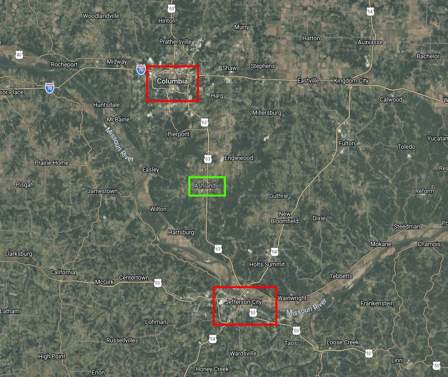
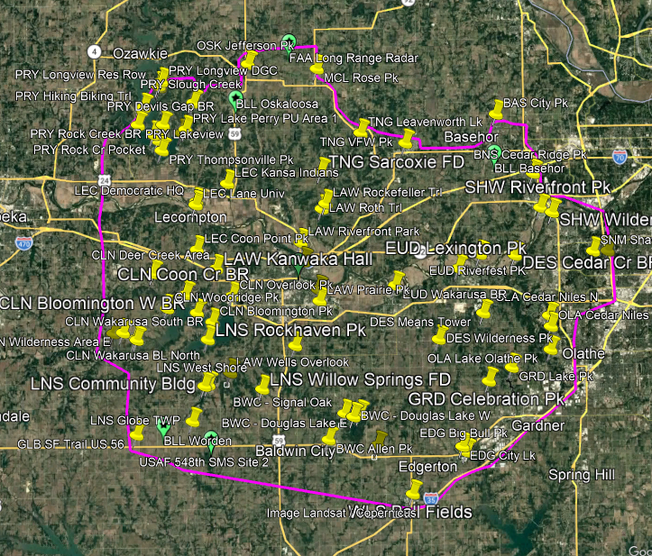

# Event Organizing
This section is for resources for event organizers. Organizers should have redundancies in nearly every area to ensure smooth event operation.

(note this file will change soon. please only use as reference for now)

Use the [event planning spreadsheet](./radio_rally_planning.ods) to plan your operating locations, authentication tables, tasks, and scoring the event. (LibreOffice ODS file)

## Planning
Planning an event takes some legwork on the front-end, but it is time well invested. Once your area of operations and your operating locations are set, you will spend much less time planning subsequent events. Consider it an investment in the club!

If you have not planned an event before, give yourself 6-12 months of planning time. This will let you do your planning in small, digestible chunks, and not have a panic a month before the event is scheduled. Once you have a list of operating locations and basic tasks, you can shorten your planning window down to 2-4 months lead time and still be able to work on the event in small chunks.

### Area of Operations
**1. Define a central core area for your area of operations (AO)**.

  Select small core area in the center of your planned area of operations. It should take no more than 5-10 minutes to travel from one side of your core area to the other. This will likely be the location of most of your base location / headquarters (HQ). This core might be the center of your city, the center of your county, or a logical space between two towns.

Example, if an event was selected to include clubs from Columbia, MO and Jefferson City, MO, the organizers might look for several locations around Ashland, MO to serve as a headquarters.

 

**2. Define the boundary of your AO.**
  
  Mark a boundary of your AO such that it balances drive time with radio time. Generally this is about 20-25 minutes of travel time in any direction. If there are excellent operating locations within a couple of extra minutes of the boundary, extend the boundary, but only if the competitors get a better experience. Note: Your AO may turn into a very interesting shape depending on the roads or trails in the area.

* Half-day county-wide events on VHF/UHF generally cover 1,000 sqare miles, or about 32 miles x 32 miles. Shoot for a maximum 20-25 minute drive in either direction from the core.

* HF events using NVIS propagation generally cover larger areas. Shoot for about 6,000 square miles, or about 75 miles x 75 miles. Plan for a maximum 45-50 minute drive in either direction from the core. 

* City-wide events with HT's or low power radios are approximately 100 square miles, or 10 miles x 10 miles or smaller. Try to keep city-wide events with no more than 10 to 15 minutes of travel time between locations.

Example, the Douglas County ARC events have some interesting locations just outside the county, and the east-west and north-south highways allow for further reach in those directions.

### Operating Locations
**1. Draft a list of operating locations (OL)**
  
  Within the AO, develop a draft list of operating locations. If you are a team of organizers, create your list in a shared Google Earth space so everyone can contribute. Have a good balance of familiar locations (larger parks and public areas) and lesser known locations (roadside and rural parks). Make sure your draft list has 70-90 locations. Several of these will be culled down to a final list. 

Name your operating locations with a 3-letter city/town prefix. For example:

* DES City Park = Desoto City Park
* BWC Allen Park = Baldwin City Allen Park
* LAW Flory Building = Lawrence Flory Building
* CLN Woodridge Park = Clinton Woodridge Park

**2. Edit your list of OL's online**

  Review all of your operating locations for suitability. Start your inspections with satellite imagery and street-view imagery. Evaluate basic accessibility, antenna clearances, open-hours, RF-environment, and options for competitor tasks.

**3. Edit your list of OL's in person**

  With your edited list of OL's, take time to visit your OL's in person. Walk around and snap photos of the area with a particular interest of things that cannot be readily seen from street-view. Snap overall photos for general context, and snap detailed photos of signs, objects, and anything else that may be useful for for planning competitor tasks.
  
  Do not go below 50 operating locations per 1,000 sq miles. 50 locations provides just enough uncertainty for participants on where they will operate. 50 locations also provides for a capacity of about eight teams without duplicating locations. Add more sites if they provide a good radio, trivia, or geographic challenge. Add more sites if you wish to host more than eight teams. Do not exceed 70-80 operating locations per 1,000 sq miles, as managing the data and tasks for the event become burdensome at that level.

When your OL's are confirmed and locked in, you will need to calculate the drive time between each location. This can be as simple as manually entering in two coordinates in Google Maps and copying the result, there are spreadsheet formulas that make use of the Google Maps API, or you might leverage AI to calculate the drive times between locations. This step is tedious, but you only have to do it once or when you re-design your event.

### Channels and Modes
Select three channels that are accessible, of interest, and present a reasonable challenge to participants. Select modes that can challenge participants and are reasonably within capabilities of your participants. 

* Primary : Most challenging.
* Alternate : Moderate challenge.
* Contingent : Least challenge. Usually uses a repeater.

For example, if a club is trying to promote DMR, make DMR the mode for the primary channel. Alternate modes might consist of something like simplex, which could be a challenge at longer distances from the HQ. Teams may need to employ directional antennas or find a nearby hill to make contact from. Contingent channels should be the easiest to access. A good default for the contingent channel is the club repeater.

Here are some ideas for bands and channels.

- **E = Easy (Technician or License Free Friendly)**
- **M = Medium**
- **C = Challenging**

#### **VHF / UHF**

| Band | FM Voice | DMR Voice | SSB Voice | APRS | JS8Call | VARA FM | VARA HF | MT63 | Meshcore |
| ----------- | ----------- | ----------- | ----------- | ----------- | ----------- | ----------- | ----------- | ----------- | ----------- |
| 10 m       | M | N/A | E   | M   | E   | N/A | M   | M   | N/A |
| 6 m        | M | N/A | E   | E   | E   | E   | N/A | M   | N/A |
| 2 m        | E | E   | C   | E   | E   | E   | N/A | M   | N/A |
| MURS       | E | N/A | N/A | N/A | N/A | N/A | N/A | N/A | N/A |
| 70 cm      | E | E   | C   | E   | E   | E   | N/A | M   | N/A |
| FRS / GMRS | E | N/A | N/A | N/A | N/A | N/A | N/A | N/A | N/A |
| 33 cm      | C | C   | C   | C   | C   | C   | N/A | C   | E   |

#### **HF**

| Band | SSB Voice | JS8Call | RTTY | HELL | Winlink |
| ----------- | ----------- | ----------- | ----------- | ----------- | ----------- |
| 6 m  | E | E | E | M | M |
| 10 m | E | E | E | E | M |
| 40 m | M | E | C | C | M |
| 60 m | C | C | C | C | C |
| 80 m | C | C | C | C | C |

### Event Format
Select a format of your event based on tasks and operating locations using the M x N format.
- M = number of operating locations
- N = number of tasks per operating location

The most common format for half day events will likely be 3 x 1 or 4 x 1.

Example:
- A 3 x 1 event consists of three operating locations and one task to perform at each operating location at the given time.
- A 1 x 3 event consists of one operating location and three tasks to perform at the operating location at various times during the event.
- A 2 x 2 event consists of two operating locations and two tasks to perform while at a given operating location. Tasks are to be performed at different times per the event's instructions.

If you're not sure how to structure an event, start with a county-wide 3 x 1 event.

### Check In

For each location, a team must check in within their calculated communications window. Teams do not have to be exactly at the location for successful check in, but the important thing is that they check in on time. To ensure net control is speaking with the correct team, each team is issued a unique authentication table at the beginning of the event. Organizers are free to select other means of authentication, however an authentication table is usually the easiest. Use the planning spreadsheet to generate an authentication table. Copy-and paste the table as an image into the information packet for the teams.

### Competitor Tasks
For each location, have a minimum of four tasks that can be completed by teams. More variety is better. Tasks should fall under the following categories: observation, measurement, retrieval, and communications. Entire events or tasks may be themed by local history, culture, a time of year, or a holiday. For example, an area may have a significant place in Cold War history, Civil War history, or other events. Assign a time to complete each ask. Be sure to give extra time in consideration of those who will be seeing this task for the first time.

#### Observation
Observation tasks require a team to carefully observe their surroundings and report on their findings.

**Read signage**

> "According to the historical marker nearby, who was the last serving postmaster of the town? (J.T. McMillan)

> "At this location, there is a sign indicating the operator of the quarry. What is the telephone number of the quarry office? (785-555-3182)

> "At this location is a bulletin board, and a unique club flyer is posted on the board. What phrase is printed at the bottom of the flyer?" ("Keeping the "fun" in Ham Radio")

> "At this location is a bulletin board, and a unique club flyer is posted on the board. On the back of the flyer is a question from the current technician class exam pool.  

**Counting**

> "At this location, there is a picnic shelter. How many picnic tables are under the shelter?" (Eight Picnic Tables)

> "At this location, there is a marina. Along the northernmost line of slips, how many uncovered slips are unoccupied? (11 - eleven)

> "Northeast of this location there is a radio tower adjacent to the water tower. On the radio tower, how many directional antennas are mounted to the tower?" (2 - two)

**Colors**

> "At the intersection of Danforth and Pape, what colors make up the logo of the business in the northwest quadrant of the intersection? (Orange, Brown, and White)"

> "Parked at the south end of the parking lot is a Chevrolet 1500 pickup with K-state bumper sticker. What color is the truck?" (White)

> "Looking west from the 3rd street railroad crossing, there is a circular sign along the tracks with the letter "D" encircled. What colors are used on that sign? (Purple and white)

**Orientation and Placement**

> "At historic building at this location, which compass direction does the front porch face?" (South)

> "Near your location is a grass-strip airport, FAA-designated "0KS4". What is the orientation of the runway? (North-South or 18/36)

> "Drive across the bridge and look for a crossed yagi antenna mounted to the railing. To which side of the bridge is the antenna mounted? From a safe location, what is your visually estimated azimuth of the antenna in degrees from true north?" (West side, oriented between 200 and 210 degrees) 

#### Retrieval
Retrieval tasks are similar to geo-caching.

> "At your location there is a bulletin board with a flyer advertising an interocitor for sale, manufactured by Supreme Electronics Service. Retrieve one of the tags from the bottom of the flyer and return to net control at the end of the event to get full points. Respond to net control with the angle of the intensifier disc." (18 degrees)

> "Attached to the perimeter fence at your location is a Master combination lock with a brass body and a Radio Rally tag. Respond to net control with the lock ID number. Net control will respond with the lock combination. Retrieve this lock and return to net control for full points."

> "Approximately one block west from your location is a volunteer fire station. Go to the fire station and ask for the Radio Rally envelope. If the firefighters are on call, they will leave it taped to the door. Retrieve the packet and follow instructions." (In the envelope is the question: "Technician class license holders may operate on 40-meters between 7.025 MHz and 7.125 MHz, but only on one mode. Which mode is permitted for technicians here?") ( Answer: CW ) 

 
#### Measurement
Measurement tasks require a team to physically interact with something in their surroundings. A measurement might require a tape measure, inclinometer, or other tool. Organizers may elect to provide the tool or have the teams provide their own. Club may choose to have a build night for a weather station a month prior to the rally and use it for the rally.

**Distance, Long**

> "Near your location is the grass-strip airport, FAA-designated "0KS4". Using a means of your choice, what is the straight-line distance (in miles plus tenths of a mile) between your assigned operating location and the hangar at "0KS4"? (1.82 miles)

> "Using the odometer on your vehicle, estimate the distance (miles plus tenths of a mile) between the dam spillway and the southern-end of the eastern guardrail on the road riding on the top of the P.T. Amos Dam?" (1.2 miles)

**Distance, Short**

> "Using the tape measure, what is the the inside width (in inches) of the footpath bridge at this location? (72 inches)

> "Using your tape measure, what is the tallest vehicle height in (feet and inches) that could park under the eaves at this location? (11 ft 3 inches)

> "Using your tape measure, what is the average center-to-center (in feet or inches) spacing of the paved boat trailer parking spots at this location?" (10 feet) 

**Angle**
> "Using the inclinometer in your phone or other device, what is the angle of the boat ramp as measured one above the water line along the ramp? (10 degrees from horizontal)

> "Using the method enclosed (Enclose instructions for angle measurement by hands), estimate the sun angle at your location. Report your time and sun angle to net control. If the sun is not visible, estimate the height angle of the nearest antenna tower." (45 degrees at 9:39 am local time)

**Sensor**
> "Using the provided sensor, transmit to net control the barometric pressure in millibars and the time of your measurement." (1010 mb at 14:01 local time)

> "Using the provided sensor, transmit to net control the water temperature in degrees Celsius and the time of your measurement." (14 C at 12:59 local time)

#### Communication
Communication tasks require a team to handle complex information or retrieve information from another source.

**Tongue Twister**

Craft a response that is difficult to speak clearly over the air.

> "At this location there is a unique club flyer posted on the bulletin board. What is the phrase written at the bottom of the flyer?" ("A proper copper coffee pot.")

**Similar Sounds**

Craft a response that challenges diction and word timing.

> "Which statement on your task card matches what is found posted at your location?"
> - "Sixteen characters make up hexadecimal numbers"
> - "Sixty caricatures make up ecumenical blunders"
> - "Thrifty managers take up influential wonders"
> - "Screened inheritors take up rebuttal plunders"

**Radio Relay**

Use your radio to relay information from another station
> "Near this location is a hidden transmitter tuned to 146.400 MHz. The transmitter reports temperature and time every seven minutes by voice message. Listen for the transmission and record the time and temperature. Report the results back to net control.

> "Near this location is a hidden transmitter tuned to 446.400 MHz requiring a 151.4 Hz tone. Key up your radio on the channel and dial "1617#" on your keypad to trigger a response. Follow the instructions and report your response to net control."

> "Near this location is another amateur radio operator, KI4RXJ, who is monitoring 146.400 MHz on DMR simplex (Talkgroup 99, Color Code 1, Timeslot 1). Make contact with them and ask for the mileage on their vehicle. Report this number back to net control."

> "Near this location is a cross-band repeater. Tune your radio to 446.400 MHz with a 88.5 Hz tone and contact N0JDS for further instructions.

> "Near this location is an AX.25 packet bulletin board operating on 146.400 MHz. Use a packet application of your choice to connect to the bulletin board and access message 137 for further instructions." 

### Set HQ Location

Plan for a primary HQ location and a backup HQ location from your list of operating locations. Secure any registration or reservations as early as practical. An HQ location could be a rented building at the fairgrounds or a shelter at a local park. Large clubs may have a mobile emergency operations trailer or vehicle that could be set up. Select an HQ that is within or close to the core of your AO. Survey the HQ location for suitability of setting up antennas and hosting all participants for the briefing and debriefing. Be sure to have suitable restroom facilities as well.

### Market the event

#### Create Communications

Create a website with all pertinent information. We suggest using the form, "https://www.yourclubwebsite.org/radiorally". Be sure to have a date near the top of your website when the information was updated. Also report the number of open slots available. Keep your site updated at least twice a week.

Create a short and impactful email to easily send and forward. Create a JPG or PNG graphic of an event flyer for distribution on various channels. When posting on social media, images get more eyes. Be sure to use the Radio Rally logo in your visual communications.

#### Announce Intent

Announce your interest and intent to your local club through a verbal announcement at a monthly club meeting. Ask the membership if they have interest and are willing to support or participate in such an event. Don't forget to solicit help for net control! At least two net control operators are required. Three or four are preferred.

#### Initial Announcement to Club

Once you have your initial event information, send an announcement out to your local club and be sure to include a link for registration. Ask for participation, and if someone wants to gather a team but cannot find teammates, to contact you directly. Help team members pair up when possible.

#### Expand Reach

Give your club members a week or so head start to register before you announce the event to a broader distribution list. If this is an official club event, give the club members an exclusive window to register. Once this period is over, announce the event to adjacent clubs in your region. Also announce the event regional email lists, contest lists, and the ARRL calendar. Talk about the event on bulletin boards and Discord servers.

### Team Registration

Set up an online form such as Google Forms to capture registration information. Remember, at least one team member must be a licensed amateur if using any amateur frequency.

* Team Name
* Team Captain Name
* Team Captain Callsign (If Applicable)
* Team Captain Email Address
* Team Member 2 Name
* Team Member 2 Callsign (If Applicable)
* Team Member 2 Email Address
* Team Member 3 Name
* Team Member 3 Callsign (If Applicable)
* Team Member 3 Email Address
* Team Member 4 Name
* Team Member 4 Callsign (If Applicable) 
* List the number of clubs or radio organizations your team members are affiliated with.
* Team Captain acknowledgement that the event is a field operating event and understands the extent of the area of operations.
* Team Captain acknowledgement that they have read the event announcement and understand the list of operating locations, what bands, frequencies, and modes will be used.
* Team Captain acknowledgement that they understand their team is responsible for safe and legal operation of their station.

### Team Packets

Build enough team packets for the maximum amount of teams you limit registration to. If you say you can accommodate eight teams, be sure to have materials for eight teams. This makes it easy to add teams last minute if you have room. Build team packets in standard 3-ring binders that hold 8.5 x 11 inch paper. This ensures paper and materials are readily available. If you are doing an HT-only event, consider doing half-sized paper (4.25 x 5.5 inches).

Team Packets must include:

* Example script for communicating with net control
* List of primary, alternate, and contingent channels and modes.
* A blank "dope card" which includes event specific bogey times, setup times, and takedown times. It also includes a place to write down the first operating location assigned.
* A table of operating location GPS coordinates and standard drive times between all operating locations.
* Blank time cards, including one extra
* Authentication table, unique to each team.
* An envelope of sealed, smaller task envelopes
* Extras as required (Maps, reference sheets, etc)

### Prizes

Given a general limitation of eight teams for a half-day event, plan to reward only the team with the top score. You may wish to offer a participation gift if this is the first time operating your event. Gift cards of $5 to $10 from a local gas station are good options. If any customized prizes are needed, be sure to get them made up early. Glassware with an etched logo is a popular and useful prize. If you can secure sponsorships, make requests as early as possible.

# Event Operation

## Packing

Begin organizing and packing your gear at least a week before the event. Be efficient and tidy! You don't want to "yard-sale" your equipment when you get to the HQ. Be a good example of organization and professionalism to others.

## HQ Setup

Arrive early, with enough time to set up your station and net control. Bring coffee and donuts for the briefing if you can!

You will need to set up at least one temporary station for all channels, and you should also have a backup plan for each station, including radio, coax, and antenna. Be sure to have a central table or workstation where at least two net controllers can operate. Do not allow more than 5 people to participate in net control or organizing activities as this will complicate operations and decision making. Be sure to make use of diplexers or triplexers if required to minimize the number of antenna deployments. 

When laying out the net control table, be sure to have the same time cards handy to jot down information when a check-in happens. Pre plan your authentications. Have all binders listed for each team. Write everything down by hand first before transferring it into the spreadsheet.

If you set up a mobile HQ be sure you have plenty of solar, battery, or generator power to last the entire day. Use a program like Radio Mobile to simulate the radio links between your station and your operating locations. Make the link a challenge, but don't make it too hard.

## Briefing
Schedule your briefing to begin no less than 30 minutes before the official start time.

### Welcome
* Greet your teams
* Lead with enthusiasm - expect a fun time
* Do introductions
* Recognize any newly licensed hams or recent upgrade licenses.
* Thank everyone for spending their time to participate
* Remind everyone of the basic event description

### Safety
#### Be approachable
Look out for one another and be approachable if your teammate thinks you might be doing something unsafe.

#### Weather
Share the weather forecast and its potential impact on the event.

#### Walking / Path of Travel
Put your eyes where you're going to put your feet. Don't get out of your vehicle without checking your surroundings.

#### Ascending / Descending
Use extra caution if you're going up or down a steep slope or stepping up or down from your truck tailgate.

#### Line of Fire / Release of Energy
Use caution when opening and closing doors and handling electrical connections.

#### Driving Safety
Drive defensively, use your mirrors, obey the speed limit, you will have plenty of time to arrive and complete your task. Don't drive distracted.

#### RF Safety
Locate antennas a sufficient distance from people. Be sure you have good grounding and bonding. Use the minimum power necessary to make contact. Do not handle coax or disconnect coax connectors while transmitting.

### Packet Orientation

Hand out the team packets and review the contents. Every team must return their packet at the end of the event!

#### Script
Here is the script to use when communicating with net control. You do not have to recite this script perfectly to get your responses into net control.

#### Channel and Mode Table
This is a table with the frequencies and modes used during the event. The primary channel is the most difficult, but gets you the most points. The alternate channel is a little easier, but gets less points, and the contingent channel is the easiest but gets the least points.

#### Task Envelopes
You have an envelope of task envelopes. The small envelopes have a number on them which corresponds with your operating location. Each operating location will have at least 4 letters (Alpha, Bravo, Charlie, etc). Do not open these envelopes until we give you your task. You will have to turn in all materials at the end of the event. If you turn it missing or too many opened envelopes, you will be penalized. 
 
#### Table of Operating Locations and Drive Times
You have had access to these locations since the event was announced. This table has every location cross referenced with every other location. The intersection of the row and column has the standard drive time between these two locations. You will need to use this table to make time card calculations.

#### Time Card
You should have at least four blank time cards. You will be using one of these per stage. We will go over how to fill this out in a bit.

#### Authentication Table
Each team will have one authentication table. This is unique to your team. Do not lose this. Net control will have a copy as well.

#### Survey
You have four survey sheets. Be sure each team member fills out a survey when you get back to HQ later. This is critical to continuous improvement of the event.

### Extras
Some events may require extra materials like maps, reference sheets, measurement tools, nomograms, or other bits required for the event.

#### Dope Card
The dope card is a reference to use when calculating your times. We use this to make adjustments to times based on weather, traffic, and other things that may change on the day of the event. Lets go over the dope card right now.

First on the dope card is the bogey time. The bogey time is some flex time we use to adjust drive times. Write this down on your dope card. For this event, the bogey time is xx minutes.

Next on the dope card is setup time. This is the setup time you are allotted to unpack and set up your station. For this event the setup time is xx minutes.

Next on the dope card is packup time. This is the time allotted to break down and pack up your station. For this event the setup time is xx minutes.

The last thing on your dope card is your first location. <read out each team's first location>

Double check that the first location number we gave you matches your task envelopes. 

Lets confirm your locations. Go over each team and have them read back and confirm their operating locations.

### Practice Time Card
Let's do a practice time card. Take out one of your time cards. You should have enough left to do the event. Raise your hand if you need another one. We are all going to do the same information.

When we are done, I'll give you the official start time, but for this example, write down 09:00 in the start box.

Now, say our HQ is at location 6. Write that down in the Transit from box.

Now, say our first location is location 3. Write that down in the transit to box.

Grab your lookup table and look up the drive time from location 6 to location 3. What is the drive time? Call it out.

The drive time is XX minutes.

What's our bogey time? XX minutes.

So we have our start time, plus the drive time, plus the bogey time. What time should we be arriving at our first location?

XX:XX

If we are given YY minutes to set up our station before check in and a ZZ minute checkin window, what is the beginning of our check in window?

When does the checkin window end?

So lets say we are within our window, and we check in with net control, we successfully authenticate, and they give us an OK time of <authetication time>. And a task Bravo.

I open up task bravo, and it tells me I have 10 minutes.

Now I have the authentication time and we have a limit on our task. We have until XX time to complete.

Lets say we complete the task on time and we can then respond at any time before the time limit.

Net control says our task response was good at XX time. 

Now we add our takedown time , and we understand our finish time. This is the seed time for the next station.
Radio Rally © 2026 by KI4RXJ Darrell Krueger is licensed under CC BY-NC-SA 4.0 
